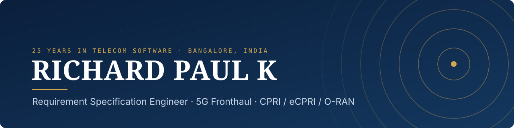
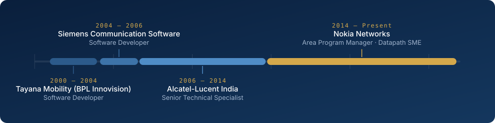

  

  
  
  

 

I lead **5G Radio Access Network programs**. I started as an engineer and still work at the level of the code. I've spent 25 years in telecom software: first writing Linux device drivers and OAM modules, and now running releases as the single point of contact for the Transport and Security domains at **Nokia Networks**.

What I do best is get large, cross-functional programs to delivery. That means turning high-level features into clear technical specifications, getting critical field issues resolved, and running root cause analysis (RCA) so the same failures don't recur. I use generative AI daily to sharpen planning, backlog management and engineering insight.

> **Currently** — Area Program Manager, Feature Leader & Datapath SME at Nokia Networks 
> **Exploring** — AI/ML across the program lifecycle, and hardware verification (SystemVerilog)

 

<table>
  <tr>
    <td width="50%" valign="top">
      <b>Program Leadership</b> 
      Single point of contact for 5G RAN Transport & Security releases. Leads multiple Feature Owner Teams across a broad transport portfolio.
    </td>
    <td width="50%" valign="top">
      <b>Security Transformation</b> 
      Led a team of system architects to plan and deliver security enhancements to base station (BTS) hardware and software.
    </td>
  </tr>
  <tr>
    <td width="50%" valign="top">
      <b>Field Quality & Recovery</b> 
      Led the Transport DU Defect Recovery mission for 7 years: recovery calls and RCA/EDA sessions on critical issues for tier-1 global operators.
    </td>
    <td width="50%" valign="top">
      <b>Datapath Architecture</b> 
      Subject Matter Expert for Cavium Fastpath QoS. Technical lead for the module's architecture and delivery.
    </td>
  </tr>
</table>

 

  

<b>Earlier roles: highlights</b>

 

**Alcatel-Lucent India** · Senior Technical Specialist · 2006 – 2014
- Team lead for the in-house Radio Network Controller (RNC) simulator, owning all test tool development
- Hands-on Linux device driver development and kernel porting
- Designed the NodeB OAM data model; led the Fault and Configuration modules

**Siemens Communication Software** · Software Developer · 2004 – 2006
- Led the Call Alarm module in RNC OAM; handled software installation on ATCA hardware
- Coordinated configuration management (CM) for the RNC project and was the go-to person for ClearCase issues

**Tayana Mobility (BPL Innovision)** · Software Developer · 2000 – 2004
- Architected an SMS messaging gateway supporting the CIMD2 and SMPP protocols
- Built system-independent building blocks for intelligent network systems for Nortel Networks

 

  
  
  
  
  

  
  
  
  
  
  
  
  

 

| | |
|---|---|
| **M.Tech, Computer Network Engineering** | Visvesvaraya Technological University · 2016 |
| **B.E., Electronics & Communication** | Kuvempu University · 2000 · *University 9th Rank* |
| **Certified Program Management Expert** | Expert Development Program · 2021 |
| **Product Management: A Complete Guide** | 2024 |
| **SystemVerilog Based Verification** | 2024 |
| **Design & Verification Using Verilog** | 2023 |

 

Open to conversations about **5G RAN programs**, **telecom datapath architecture**, and **applying AI to engineering delivery**. The best way to reach me is [LinkedIn](https://www.linkedin.com/in/pkrichard) or [email](mailto:richard.pk@gmail.com).
